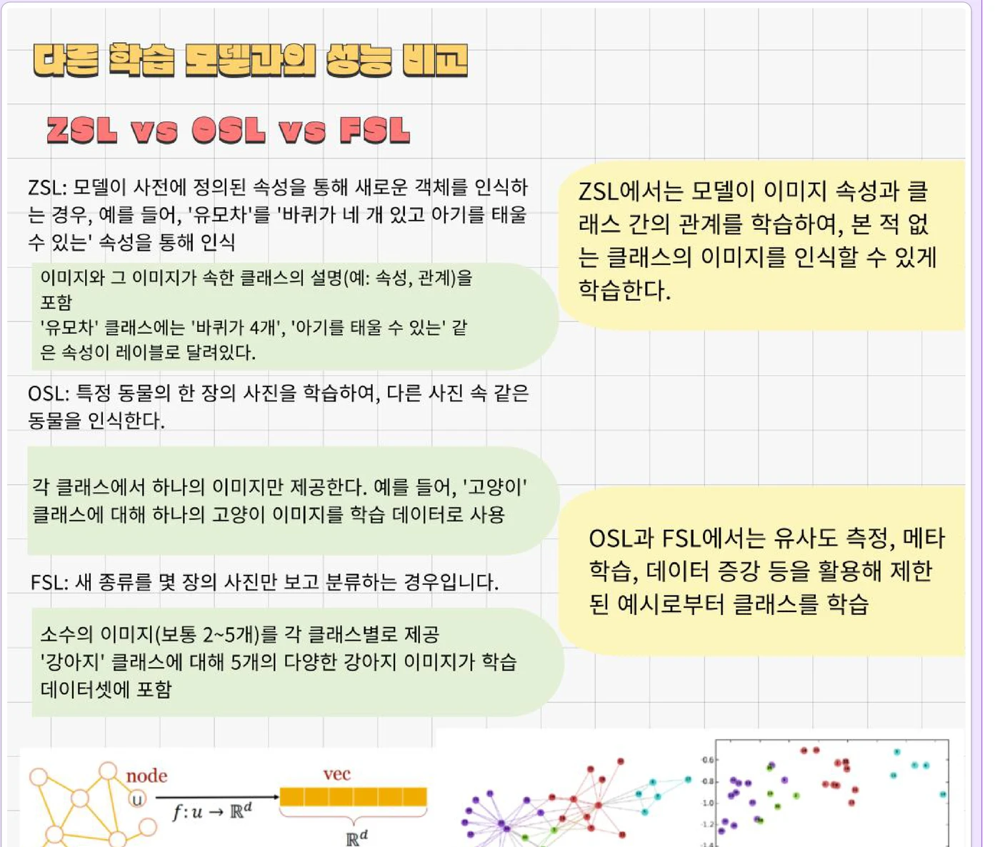
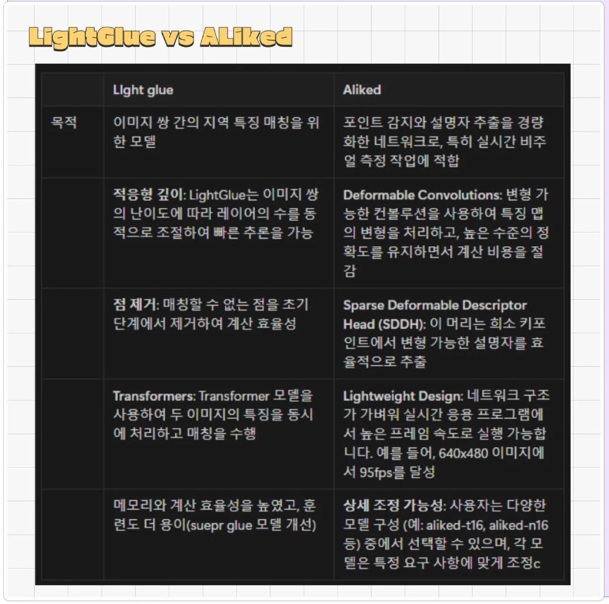

# ChADa — AI 연구 스터디

> 읽은 것을 **돌려보기 전에는 안다고 하지 않는** 습관이 여기서 생겼습니다.

| | |
|---|---|
| 기간 | 2023.07 – 2025.07 (2년) · 한국외국어대학교 교내 스터디 |
| 형태 | 한국외국어대학교 교내 AI 연구 스터디 |
| 나의 역할 | 논문 리뷰 · 모델 구현 · 발표 · 대회 참가 |
| 자료 | 저장소 정리 중 — 개별 자료는 요청 시 공유 |

`Study`  `PyTorch`  `ResNet`  `CNN / RNN / LSTM`

저장소 정리 중 · 자료 요청 시 공유

---

## 개요

### 나의 활동

| | |
|---|---|
| **반복** | 논문 리뷰 → **모델 직접 구현** → 발표 |
| **규칙** | 읽고 끝내지 않고 반드시 돌려보기 |
| **다룬 것** | 논문 리뷰(Siamese CBOW 등) · CNN / RNN / LSTM 구현 |
| **대회** | **ETRI Fashion-How Season 5** — 베이스라인 분석 · 데이터 매핑 및 증강 · ResNet 기반 모델링 · 버전별 결과 비교 |
| **2024 여름** | Image Matching Challenge (**ALIKED · LightGlue**) · ETRI Fashion How **Zero-shot 학습**과 Knowledge Graph Embedding 정리 |

> **2024 ETRI Fashion How** — 셋을 나란히 놓고 ‘무엇이 다른가’부터 적었다. 읽은 것을 비교표로 바꾸지 않으면 다음 주에 다시 읽게 됩니다.

### 핵심 성과 · Key Achievements

- **2년간 리뷰 → 구현 → 발표 반복** 읽고 끝내지 않고 반드시 돌려보는 것이 스터디 규칙이었고, 2023.07부터 2025.07까지 이어갔습니다
- **ETRI Fashion-How 참가** **Season 5**에서 베이스라인 분석 · **데이터 매핑 및 증강** · ResNet 기반 모델링까지 직접 돌렸습니다
- **바꾼 것과 움직인 것을 표로** 버전을 바꿔가며 **결과를 표로 남기는** 방식을 여기서 익혔습니다. 적어두지 않으면 다음 주에 같은 실험을 다시 하게 됩니다
- **기반이 된 것** 이후 Bimp의 YOLO 모델링, 영화 추천의 GMF/NNMF 비교 실험이 전부 이 스터디에서 만든 **“돌려보고 기록한다”** 절차 위에서 진행됐습니다

### 남은 것

| | |
|---|---|
| **습관** | 버전을 바꿔가며 **결과를 표로** 남기는 것 |
| **이유** | 무엇을 바꿨을 때 무엇이 움직였는지 적어두지 않으면, 다음 주에 같은 실험을 다시 하게 됩니다. |

> **자료 정리 중입니다.** 2년치 노트북과 발표자료가 흩어져 있어 공개 저장소로 묶지 못했습니다. 필요하시면 개별 자료로 보내드립니다.

> **습관의 실물** — 논문 둘을 읽고 끝내지 않고 항목을 맞춰 표로 세웠다. Bimp의 YOLO 버전 비교도, 영화 추천의 GMF/NNMF 비교도 이 형식 위에서 돌았습니다.

---

## 기술 스택

| | |
|---|---|
| Model | PyTorch · ResNet · CNN / RNN / LSTM |
| Paper | Siamese CBOW 외 논문 리뷰 |
| Competition | ETRI Fashion-How Season 5 (베이스라인 · 데이터 증강 · 모델링) |

---

전체 포트폴리오 → **https://sungeun-portfolio.vercel.app/projects/chada**
